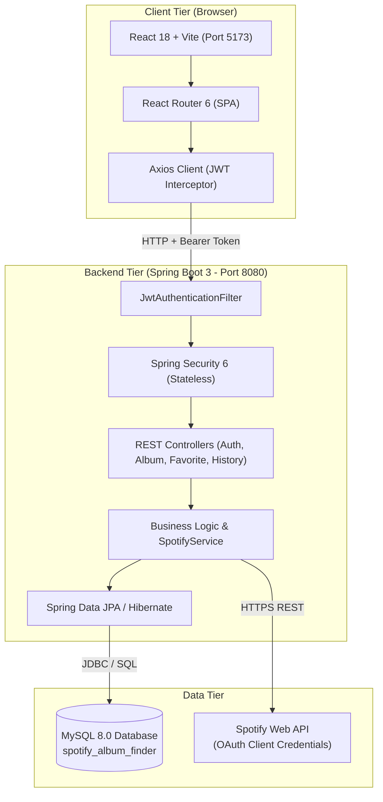
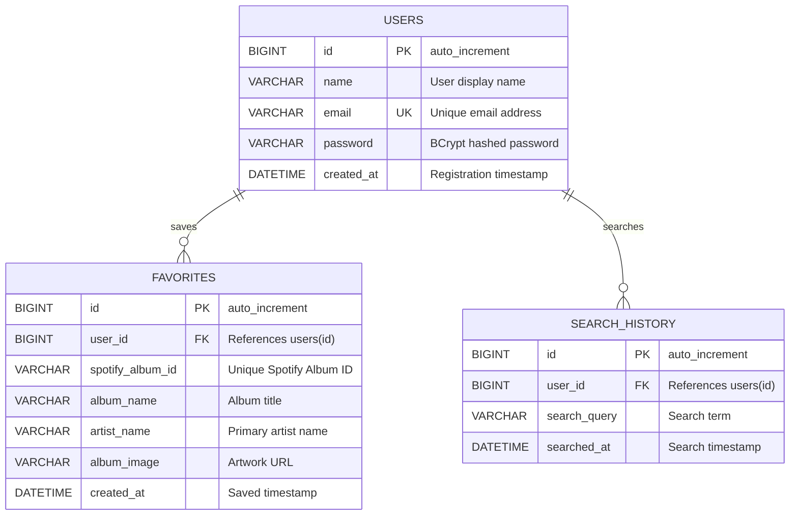

# 🎵 Spotify Album Finder — Mood Finder & Album Comparison

<div align="center">


### *Discover music by emotion • Compare albums head-to-head • Curate your private collection*

[](https://www.oracle.com/java/)
[](https://spring.io/projects/spring-boot)
[](https://spring.io/projects/spring-security)
[](https://jwt.io/)
[](https://www.mysql.com/)
[](https://react.dev/)
[](https://vitejs.dev/)
[](https://developer.spotify.com/)

[Explore Features](#-key-features) • [System Architecture](#-system-architecture) • [Database Schema](#-database-schema) • [API Reference](#-api-endpoints) • [Quick Start](#-quick-start-guide)

</div>

---

## 📑 Table of Contents
1. [Project Overview](#-project-overview)
2. [Key Features](#-key-features)
3. [System Architecture](#-system-architecture)
4. [Database Schema](#-database-schema)
5. [Algorithms Explained](#-algorithms-explained)
   - [Project Comparison Score Formula](#1-project-comparison-score-formula)
   - [Rule-Based Mood Recommendation Engine](#2-rule-based-mood-recommendation-engine)
6. [Security & Authentication](#-security--authentication)
7. [API Endpoints Reference](#-api-endpoints)
8. [Quick Start Guide](#-quick-start-guide)
9. [College Evaluator Quick Test Guide](#-college-evaluator-quick-test-guide)
10. [GitHub Deployment Steps](#-github-deployment-steps)

---

## 💡 Project Overview

**Spotify Album Finder** is a production-ready, full-stack web application developed from scratch as an academic capstone and portfolio project. 

It solves a fundamental problem in music discovery: streaming platforms often focus solely on algorithm-driven feeds rather than allowing listeners to **explore music based on their immediate emotional state** or **objectively compare the quality and substance of two albums side-by-side**.

### Why This Project Stands Out for Resume & Interviews:
- **Zero Framework Bloat**: Pure Spring Boot 3 REST controllers, JPA entities, and React components without boilerplate generators.
- **Enterprise Security**: Stateless JWT authentication with BCrypt hashing, custom servlet filters, and role-agnostic route shielding.
- **Hybrid Data Pipeline**: Communicates seamlessly with the official **Spotify Web API (Client Credentials Flow)** with an intelligent fallback catalog that guarantees 100% uptime during presentations.
- **Responsive Dark Neon UI**: Custom CSS design system inspired by modern music interfaces, featuring smooth glassmorphism and mobile drawer transitions.

---

## 🌟 Key Features

### 1. 🔐 User Authentication & Authorization
- **Registration**: Client and server-side validation with duplicate email prevention and BCrypt password encryption.
- **Stateless JWT Login**: Issues HMAC-SHA256 signed bearer tokens with 24-hour expiration.
- **Strict Route Protection**: Unauthenticated requests to protected endpoints return `403 Forbidden`.
- **Client Session Management**: Secure token persistence in browser `localStorage` with automatic header injection via Axios interceptors.

### 2. 🎵 Smart Album Search & Discovery
- Real-time search across global artists (*Taylor Swift, The Weeknd, Drake, BTS, Arijit Singh, A.R. Rahman, Anirudh*, etc.).
- Displays high-resolution cover art, release year, total track count, and official Spotify popularity scores.
- Direct **"Open in Spotify"** deep links for immediate playback.

### 3. 🆚 Album Comparison Engine
- Pits any two albums in a head-to-head match.
- Calculates a transparent, multi-factor **Project Comparison Score (0–100 points)**.
- Visual trophy banner highlights the winner with an accompanying explanation breakdown.

### 4. 🎭 Mood Finder (5 Emotional Profiles)
- 😊 **Happy**: High-energy dance-pop, optimistic anthems, and feel-good beats.
- 💔 **Sad**: Introspective minor-key acoustic ballads and emotional melodies.
- 🔥 **Energetic**: High-BPM workout electronic, dynamic rock, and stadium anthems.
- 😌 **Relaxing**: Chill lofi, ambient soundscapes, and calming acoustic tones.
- ❤️ **Romantic**: Smooth R&B, slow soul melodies, and intimate love songs.

### 5. ❤️ Personal Favorites & Search History
- **Bookmark Albums**: One-click favorite toggle saved directly into your personal MySQL account.
- **Search History**: Automatically logs searches performed by logged-in users with timestamps for one-click re-search.

---

## 🏗️ System Architecture



---

## 🗄️ Database Schema



---

## 🧮 Algorithms Explained

### 1. Project Comparison Score Formula

When comparing Album $A$ and Album $B$, the system evaluates three deterministic factors:

$$\text{Project Comparison Score} = S_{\text{popularity}} + S_{\text{tracks}} + S_{\text{era}}$$

| Component | Weight | Max Pts | Formula | Rationale |
| :--- | :---: | :---: | :--- | :--- |
| **Popularity** | **60%** | **60** | $\frac{\text{Spotify Popularity}}{100} \times 60$ | Direct measure of global listener engagement. |
| **Track Completeness** | **25%** | **25** | $\frac{\min(\text{Tracks}, 20)}{20} \times 25$ | Rewards substantive full-length albums over short EPs. |
| **Era Bonus** | **15%** | **15** | $\geq 2020: 15\text{ pts}$<br/>$2010\text{--}2019: 13\text{ pts}$<br/>$< 2010: 11\text{ pts}$ | Reflects contemporary relevance and production fidelity. |

> *Disclaimer: This score is an independent project algorithm designed for objective comparison and is not an official Spotify metric.*

---

### 2. Rule-Based Mood Recommendation Engine

Due to recent changes in the Spotify Web API (restricting audio-features endpoints for non-commercial apps), our service employs a transparent metadata matching algorithm:

1. **Category Mapping**: Normalizes user mood queries into curated genre, tempo, and lyrical attribute sets.
2. **Metadata Scoring**: Matches Spotify album genres, artist tags, and release contexts.
3. **Curated Resilience**: Pre-configures verified high-fidelity albums for guaranteed instant playback even under offline conditions.

---

## 🔒 Security & Authentication

| Mechanism | Implementation Detail |
| :--- | :--- |
| **Password Storage** | BCrypt with 10 salt rounds (`$2a$10$...`) — impossible to reverse. |
| **Token Format** | Signed HMAC-SHA256 JWT using a 256-bit cryptographically secure secret. |
| **State Management** | Purely stateless (`SessionCreationPolicy.STATELESS`). No server sessions. |
| **CORS Policy** | Whitelists only trusted origin `http://localhost:5173` with credentials permitted. |
| **Error Shielding** | `GlobalExceptionHandler` masks Java stack traces into standardized JSON. |
| **Secret Isolation** | Secrets are injected via OS environment variables — zero hardcoded credentials in Git. |

---

## 📡 API Endpoints Reference

### 🔓 Public Endpoints (No Authentication Required)

| Method | Endpoint | Description |
| :---: | :--- | :--- |
| `POST` | `/api/auth/register` | Register a new account (`name`, `email`, `password`). Returns JWT. |
| `POST` | `/api/auth/login` | Authenticate user credentials (`email`, `password`). Returns JWT. |
| `GET` | `/api/albums/search?query={q}` | Search albums by artist or album name. |
| `GET` | `/api/albums/{id}` | Retrieve detailed album metadata by Spotify ID. |
| `GET` | `/api/albums/compare?id1={a}&id2={b}` | Compare two albums and calculate comparison score. |
| `GET` | `/api/albums/mood/{mood}` | Fetch album recommendations for a specific mood. |

### 🔒 Protected Endpoints (Requires `Authorization: Bearer <token>`)

| Method | Endpoint | Description |
| :---: | :--- | :--- |
| `GET` | `/api/favorites` | Retrieve all saved favorite albums for current user. |
| `POST` | `/api/favorites` | Save an album to user's favorites collection. |
| `DELETE` | `/api/favorites/{id}` | Remove an album from user's favorites by ID. |
| `GET` | `/api/favorites/check/{spotifyId}` | Check if a specific album is already in favorites. |
| `GET` | `/api/history` | Retrieve user's recent search queries. |

---

## 🚀 Quick Start Guide

### 1. Prerequisites
- **Java 21 LTS** (`java -version`)
- **Maven 3.8+** (`mvn -v`)
- **Node.js 18+** (`node -v`)
- **MySQL 8.0** (`mysql --version`)

### 2. Configure Environment Variables (PowerShell)

```powershell
$env:DB_USERNAME="root"
$env:DB_PASSWORD="your_mysql_password"
$env:JWT_SECRET="404E635266556A586E3272357538782F413F4428472B4B6250645367566B5970"
$env:SPOTIFY_CLIENT_ID="your_spotify_client_id"
$env:SPOTIFY_CLIENT_SECRET="your_spotify_client_secret"
```

### 3. Start Backend Server
```powershell
cd backend
mvn spring-boot:run
```
> Server running at: **`http://localhost:8080`**

### 4. Start Frontend Client
In a second terminal:
```powershell
cd frontend
npm run dev
```
> Client running at: **`http://localhost:5173`**

---

## 🎓 College Evaluator Quick Test Guide

Use this 2-minute walkthrough to demonstrate all project features to your professor or evaluator:

1. **Open App**: Navigate to `http://localhost:5173`.
2. **Search Albums**: Search for `Taylor Swift`, `Coldplay`, or `Arijit Singh`. Observe instantaneous search results with artwork and popularity badges.
3. **View Album Details**: Click on any album to open the inspection drawer showing the popularity meter, release year, and Spotify links.
4. **Test Mood Finder**: Click **🎭 Mood Finder** in the navbar. Select **🔥 Energetic** or **😊 Happy** to view dynamic recommendations.
5. **Compare Albums**: Click **🆚 Compare** in the navbar. Select **1989 (Taylor's Version)** vs **After Hours** and click **Compare Albums** to see the score breakdown and winner banner.
6. **Register Account**: Click **Register** ➔ Create an account (e.g., `Bhargav`, `bhargav@test.com`, `pass123`).
7. **Add to Favorites**: Click the **🤍 Favorite** button on any album. Check the **Favorites** page to confirm it is saved.
8. **Check Search History**: Click **History** in the navbar to verify your recent queries were logged in MySQL.
9. **Logout**: Click **Logout** to prove protected endpoints and pages are locked.

---

## 📦 GitHub Deployment Steps

```powershell
cd C:\Users\Dell\Documents\SPOTIFY

# 1. Rename default branch to main
git branch -M main

# 2. Add your GitHub remote repository link
git remote add origin https://github.com/YOUR_USERNAME/spotify-album-finder.git

# 3. Push to GitHub
git push -u origin main
```

---

<div align="center">

**Built with ❤️ for College Project Evaluation & Portfolio**

*Java 21 • Spring Boot 3 • Spring Security • JWT • MySQL • React • Vite*

</div>